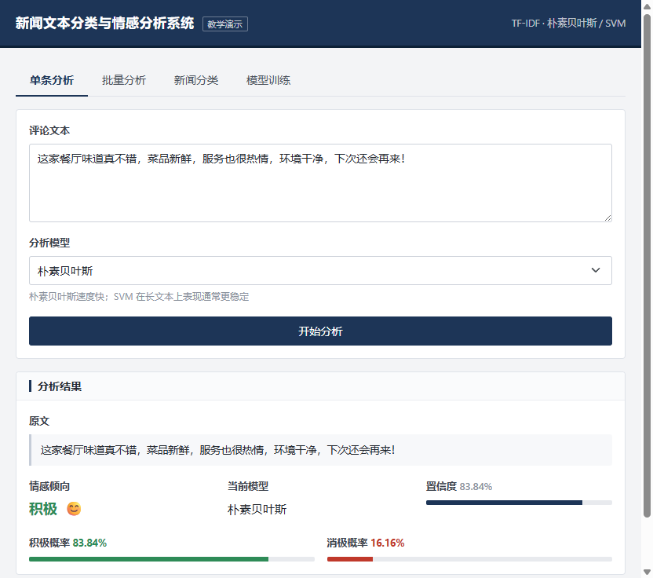
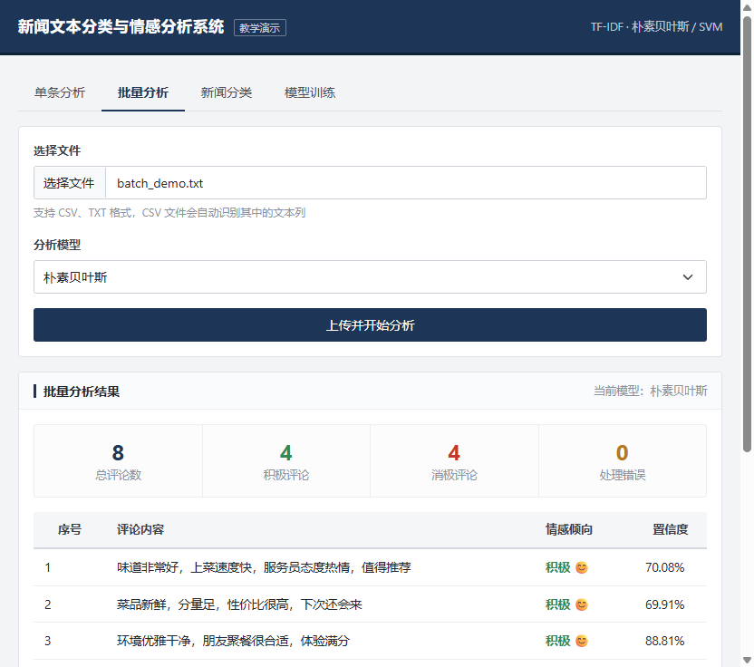
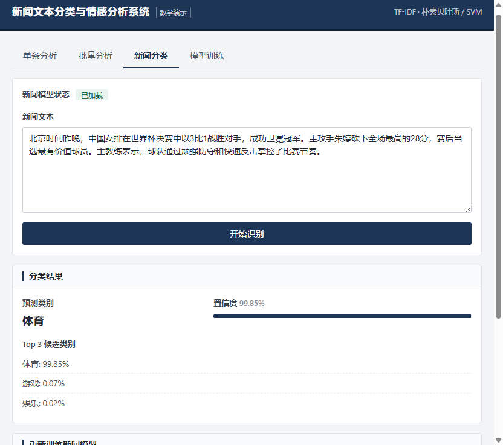
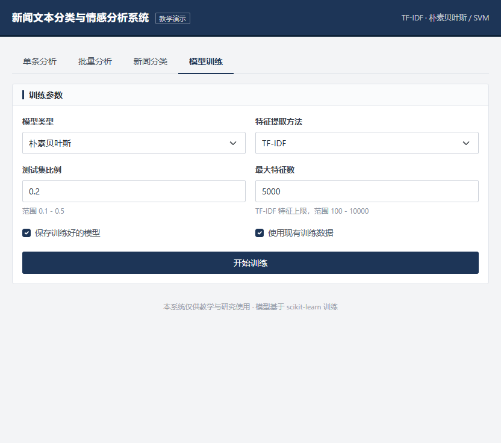
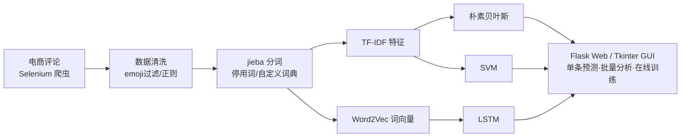

# 商品评论情感分析系统
# 源码获取： https://mbd.pub/o/bread/YZaVmZ1rbA==

基于机器学习与深度学习的中文商品评论情感分析系统，覆盖**数据爬取 → 文本预处理 → 模型训练 → 在线预测 → 可视化交互**全流程。提供 Flask Web 端与 Tkinter 桌面端两种交互方式，支持朴素贝叶斯、SVM、LSTM（Word2Vec）三类模型对比，并附带基于 cnews 数据集的新闻文本分类模块。


## 功能特性

- **评论数据爬取**：基于 Selenium 自动化爬取天猫等电商平台商品评论，支持翻页、滚动加载与手动扫码登录
- **中文文本预处理**：emoji 过滤、正则清洗、jieba 分词、停用词过滤、自定义领域词典
- **多模型情感分析**：
  - 朴素贝叶斯（MultinomialNB + TF-IDF）—— 二分类，轻量快速
  - 支持向量机（SVM + TF-IDF）—— 二分类，效果最优
  - LSTM（Word2Vec 词向量 + Embedding + LSTM）—— 正面 / 中性 / 负面三分类
- **新闻文本分类**：基于 cnews 数据集，支持体育、财经、科技等 10 个类别，返回 Top-K 类别概率
- **在线训练**：Web 端一键训练模型，后台线程执行，SSE 实时推送训练进度，自动保存并可切换模型
- **批量分析**：上传 CSV / TXT 文件批量预测，输出正负向统计结果
- **RESTful API**：情感分析、新闻分类、模型训练等能力均提供 JSON 接口
- **双端交互**：Flask Web 界面 + Tkinter 桌面 GUI
- **结果可视化**：训练曲线、混淆矩阵、词云图等绘图脚本

## 界面演示

| 单条情感分析 | 批量文件分析 |
| :---: | :---: |
|  |  |
| **新闻文本分类** | **模型在线训练** |
|  |  |

## 模型效果

在商品评论数据集上的测试集表现（模型保存目录中的实测结果）：

| 模型 | 特征 / 输入 | 任务 | 测试准确率 |
| --- | --- | --- | :---: |
| 朴素贝叶斯 MultinomialNB | TF-IDF | 情感二分类 | **86.11%** |
| 支持向量机 SVM（linear） | TF-IDF | 情感二分类 | **88.88%** |
| LSTM | Word2Vec（100 维） | 情感三分类（正/中/负） | 见训练日志 |
| 朴素贝叶斯 MultinomialNB | TF-IDF | 新闻十分类 | **94.33%** |

> 准确率随数据划分比例（`test_size`）与数据版本浮动，可在 Web 端重新训练获取最新结果。

## 技术架构

系统整体数据流：



**技术栈**

| 层次 | 技术 |
| --- | --- |
| Web 框架 | Flask 2.3 |
| 数据处理 | pandas、NumPy |
| 中文分词 | jieba |
| 机器学习 | scikit-learn（TF-IDF / MultinomialNB / SVM） |
| 深度学习 | TensorFlow + Keras、gensim Word2Vec |
| 数据采集 | Selenium、Requests、BeautifulSoup |
| 可视化 | Matplotlib、Seaborn、WordCloud |
| 桌面端 | Tkinter |

## 项目结构

```
SentimentAnalysisOfProductReview/
├── web_app.py                  # Flask Web 应用入口（路由/训练/预测/API）
├── train_simple_model.py       # 朴素贝叶斯模型训练脚本
├── simple_test.py              # 简单模型测试
├── test_sentiment.py           # 情感分析命令行测试
├── requirements.txt            # Python 依赖
├── 部署教程.md                  # 详细部署文档
├── data/                       # 情感分析语料（pos/neg/neutral 等）
├── newsdata/                   # cnews 新闻语料（train/val/test）
├── review_crawler/             # 电商 / 餐饮评论爬虫
│   ├── crawler.py
│   └── restaurant_crawler.py
├── review_treatment/           # 文本预处理（分词、停用词）
│   ├── review_pretreatment.py
│   ├── stopword.txt
│   └── user_dict.txt
├── lstm/                       # LSTM 模型训练、预测与绘图
│   ├── train_lstm.py
│   ├── lstm_test.py
│   ├── draw.py
│   └── draw_plot.py
├── svm/                        # SVM 训练脚本与向量化数据
├── model/                      # 已训练 LSTM / Word2Vec 模型
├── simple_model/               # 已训练朴素贝叶斯模型
├── svm_model/                  # 已训练 SVM 模型
├── news_model/                 # 已训练新闻分类模型
├── GUI/                        # Tkinter 桌面界面
│   ├── main_page.py
│   └── simple_main_page.py
├── templates/                  # Web 页面模板
└── static/                     # Web 静态资源（CSS / JS）
```

## 快速开始

### 1. 环境要求

- Python 3.8 – 3.10（推荐 3.9）
- 内存 4GB 以上（训练 LSTM 建议 8GB）
- Chrome 浏览器 + 对应版本 ChromeDriver（仅爬虫功能需要）

### 2. 获取代码并安装依赖

```bash
git clone https://github.com/<your-username>/SentimentAnalysisOfProductReview.git
cd SentimentAnalysisOfProductReview

# 创建并激活虚拟环境（推荐）
python -m venv venv
# Windows
venv\Scripts\activate
# Linux / macOS
source venv/bin/activate

# 安装依赖
pip install -r requirements.txt
# 国内网络可使用清华镜像
pip install -r requirements.txt -i https://pypi.tuna.tsinghua.edu.cn/simple
```

### 3. 启动 Web 应用

项目已内置预训练模型，安装依赖后可直接启动：

```bash
python web_app.py
```

浏览器访问：<http://127.0.0.1:5000>

### 4. 启动桌面 GUI（可选）

```bash
python GUI/simple_main_page.py
```

## 使用指南

### Web 端功能

1. **单条分析**：输入评论文本，选择朴素贝叶斯或 SVM 模型，返回情感倾向与正/负向概率
2. **批量分析**：上传 CSV（自动识别 `text` / `comment` / `review` 列）或 TXT（每行一条），返回逐条结果与统计
3. **新闻分类**：输入新闻文本，返回所属类别及 Top-3 类别概率
4. **在线训练**：选择模型类型与测试集比例后启动训练，页面实时显示进度、准确率、精确率、召回率、F1 与混淆矩阵，训练完成后模型自动保存并可直接切换使用

### API 调用示例

**情感分析**

```bash
curl -X POST http://127.0.0.1:5000/api/analyze \
     -H "Content-Type: application/json" \
     -d '{"text": "这件衣服质量很好，非常满意，推荐购买！", "model_type": "svm"}'
```

响应：

```json
{
  "text": "这件衣服质量很好，非常满意，推荐购买！",
  "sentiment": "positive",
  "confidence": 0.9521,
  "positive_prob": 0.9521,
  "negative_prob": 0.0479,
  "emoji": "😊"
}
```

**新闻分类**

```bash
curl -X POST http://127.0.0.1:5000/api/news_analyze \
     -H "Content-Type: application/json" \
     -d '{"text": "新闻文本内容……", "top_k": 3}'
```

**触发模型训练**（异步执行，通过 `/training_progress` SSE 接口订阅进度）

```bash
curl -X POST http://127.0.0.1:5000/train_model \
     -H "Content-Type: application/json" \
     -d '{"model_type": "svm", "test_size": 0.2}'
```

### 模型训练

若预训练模型缺失，或需要使用自有语料重新训练：

```bash
# 朴素贝叶斯（情感二分类）
python train_simple_model.py

# SVM（在 svm 目录下运行）
cd svm && python train_svm.py

# LSTM（三分类，在 lstm 目录下运行）
cd lstm && python train_lstm.py
```

新闻分类模型可直接在 Web 端「在线训练」页面训练，语料位于 `newsdata/`。

### 评论爬取

1. 从 <https://chromedriver.chromium.org/> 下载与本地 Chrome 版本匹配的 ChromeDriver
2. 修改 [review_crawler/crawler.py](review_crawler/crawler.py) 中的 `self.path` 为你的 ChromeDriver 路径，并将目标 URL 替换为待爬取的商品评论页
3. 运行后在弹出的浏览器中手动完成登录，回到终端按回车开始自动翻页爬取，结果保存为 `review_crawler/review.csv`

```bash
cd review_crawler
python crawler.py
```

## 数据集说明
https://github.com/968626/Commodity-Review-Sentiment-Analysis-System/issues
| 数据 | 文件 | 规模 | 说明 |
| --- | --- | --- | --- |
| 正面评论 | `data/pos.csv` | 约 1.07 万条 | 标签 positive |
| 负面评论 | `data/neg.csv` | 约 1.04 万条 | 标签 negative |
| 中性评论 | `data/neutral.csv` | 约 0.44 万条 | LSTM 三分类使用 |
| 测试集 | `data/test_set.csv` | 297 条 | 预留测试语料 |
| 新闻语料 | `newsdata/cnews.*.txt` | cnews 标准数据集 | 10 个类别，train/val/test 划分 |

## 常见问题

**1. `pip install` 安装慢或失败？**
使用国内镜像：`pip install -r requirements.txt -i https://pypi.tuna.tsinghua.edu.cn/simple`。TensorFlow 安装失败请确认 Python 为 64 位且版本在 3.8–3.10 之间。

**2. 启动提示模型文件不存在？**
运行对应训练脚本重新生成模型，或直接在 Web 端「在线训练」页面训练（朴素贝叶斯 / SVM / 新闻模型均支持）。

**3. LSTM 训练报 API 兼容错误？**
[lstm/train_lstm.py](lstm/train_lstm.py) 基于早期 Keras 2.x / gensim 3.x 接口编写（如 `nb_epoch`、`model.wv.vocab`）。在 TensorFlow 2.13 / gensim 4.x 下需将其替换为 `epochs`、`model.wv.key_to_index` 等新接口；Web 端的朴素贝叶斯与 SVM 功能不依赖该模块，不受影响。

**4. 爬虫提示 ChromeDriver 错误？**
确保 ChromeDriver 与 Chrome 大版本一致，路径已在代码中正确配置，并在运行时手动完成登录。

更多环境配置与生产部署（Gunicorn / Waitress / Nginx）说明见 [部署教程.md](部署教程.md)。

## 免责声明

本项目仅供学习交流与毕业设计研究使用。爬虫模块请遵守目标网站的 `robots.txt` 规则与用户协议，控制访问频率，勿用于任何商业用途或大规模抓取；因不当使用造成的一切后果由使用者自行承担。
